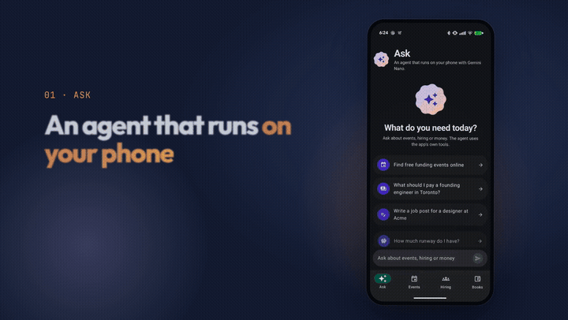

# FounderPad

An Android app that helps a new founder get started. It has an on-device agent
(Gemini Nano through ML Kit GenAI) whose tools are the app's own AppFunctions.
The same AppFunctions are available to the Gemini app through the Connected
Apps platform.

[](docs/screenshots/launch.mp4)

Watch the [launch video](docs/screenshots/launch.mp4) (1 min) or the
[full demo recording](docs/screenshots/demo.mp4) (2 min).

## Features

| Tab | What it does | Data |
| --- | --- | --- |
| Ask | Chat with an agent that runs on the phone. It calls the app's tools and shows each tool call. Before it records a transaction, it asks you to confirm. | ML Kit GenAI agent (`genai-agent`), Gemini Nano |
| Events | Find events to meet people, meet investors and find office space. Filter by type, text, city and price. | Live discovery via `FounderEventDiscoveryService`: Firebase AI Logic (`gemini-3.8-flash` + `Tool.googleSearch()` grounding) & Luma public discovery endpoint (`api.lu.ma/discover/get-paginated-events`), with offline seed fallback. |
| Hiring | Salary and equity ranges by role, level and city. Write a job post, then rewrite it on device (Professional, Friendly, Shorter). See candidates and a hiring checklist. | Mock data. Rewriting uses ML Kit GenAI Rewriting (`genai-rewriting`). |
| Books | Add money in and out (auto-categorized). See cash, monthly burn, runway, expenses by category and a monthly table. | Mock, in memory |

## Agent tools (AppFunctions)

Defined in `app/src/main/java/com/startupassistant/StartupTools.kt`. The KDoc on
each function is the tool description that the model reads.

| Tool | Kind |
| --- | --- |
| `find_events(topic, category, city, freeOnly)` | read |
| `get_salary_range(role, level, location)` | read |
| `find_candidates(role, remoteOnly)` | read |
| `draft_job_post(role, companyName, companyPitch, level, location)` | read |
| `get_runway()` | read |
| `add_transaction(description, amountUsd, date)` | write, needs user confirmation in the app |

## Requirements

- Android Studio with AGP 9.4 and Gradle 9.6 (the wrapper is included)
- For the Ask tab and rewriting: a device with Gemini Nano (for example Pixel 9 or later)
  on Android 14 or later, enrolled in the AICore Developer Preview
- For the Gemini app to call the tools: Android 16 (API 36) or later

The Events, Hiring and Books tabs work on any device with Android 8.0 (API 26) or later.

## Build and run

```
./gradlew :app:installDebug
./gradlew :app:testDebugUnitTest
```

The build needs JDK 21.

### Get a debug APK from CI

The `Debug APK` workflow builds the debug APK for each push to `main`, for
each pull request, and when you start it manually.

1. Open the **Actions** tab and select a green `Debug APK` run.
2. Download the `founderpad-debug-<number>` artifact. It is a zip file.
3. Unzip it and install `app-debug.apk` on the phone. You can use
   `adb install -r app-debug.apk`, or open the file on the phone.

Each CI run signs the APK with a new debug key. If an install fails with a
signature error, remove the app from the phone first, then install again.

Test a tool without the agent:

```
adb shell cmd app_function list-app-functions --package com.startupassistant
adb shell cmd app_function execute-app-function --package com.startupassistant --function <function id from the list> --parameters '{}'
```

## Replace a mock with a real source

Each feature reads data through an interface in `app/src/main/java/com/startupassistant/data/`:
`EventRepository`, `HiringRepository` and `BooksRepository`. Write a new
implementation and change it in `AppGraph.kt`.
